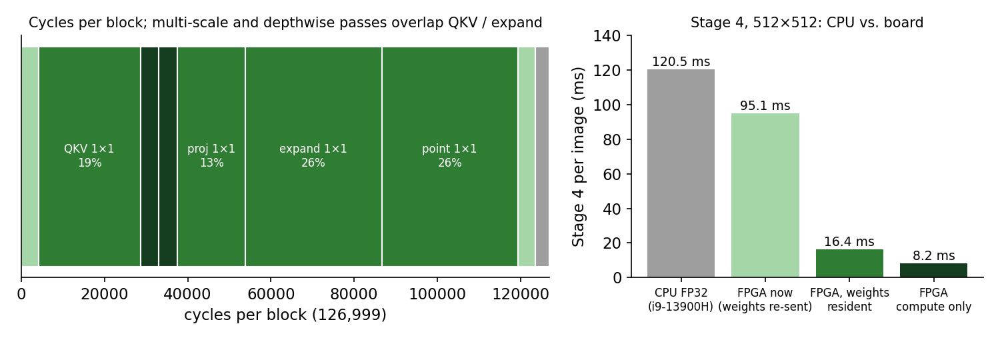

<h1 align="center">Bit-Exact FPGA Accelerator for EfficientViT-B1 Stage 4</h1>
<p align="center">A SystemVerilog accelerator for the four linear-attention blocks of EfficientViT-B1 Stage 4 on an AMD Xilinx VCU128, driven from a PyTorch segmentation network over PCIe. The INT8 version runs all four blocks in 1.55 ms per image on the board, bit-exact against its integer model.</p>
<p align="center"></p>

## Overview

EfficientViT-Seg-B1 is a semantic segmentation network whose last backbone stage (Stage 4, `backbone.stages[3]` in the code) holds four identical blocks. Each block is a multi-scale ReLU linear attention module (LiteMLA) followed by an MBConv. This project moves those four blocks onto an FPGA and leaves the rest of the network in PyTorch on the host CPU. A 512x512 input gives 256 tokens of 256 channels at Stage 4, and one RTL design runs all four blocks by loading different weights.

The repository holds two versions. The first board version, v4.1 (`rtl/`), uses int16 fixed point (activations Q10.5, weights Q4.11). Its RTL was written to match two integer models written separately: one follows the RTL (`model/rtl_model.py`) and one follows the PyTorch network (`model/evit_hw_golden/evit_hw_golden.py`). The board output matches them word for word. Between design versions v2 and v4, cycles per block fell from 1,055,995 to 126,999 at the same 512x512 workload, an 8.3x reduction. Most of the gain came from a cluster of eight 16x16 systolic arrays with shadow weights; the rest came from overlapping the attention, multi-scale and depthwise passes with the 1x1 convolutions. [`docs/DESIGN.md`](docs/DESIGN.md) explains the design decisions, the version history and the debugging of v4.1.

The current version, v6 (`rtl_v6/`), keeps that dataflow and changes three things around it: INT8 arithmetic with two products per DSP, the weights of all four blocks resident in UltraRAM so that one start runs the whole stage, and a 200 MHz accelerator clock behind a PCIe Gen3 x8 link. On the board it processes an image in 1.55 ms instead of 95.1 ms, bit-exact against its integer model, with no loss of mIoU.

## Results

### v6, INT8

All four Stage 4 blocks at 512x512 input, measured on the VCU128 unless stated otherwise.

| Metric | Value | Source |
|---|---|---|
| Stage 4 per image, four blocks from one start | 1.55 ms median of 50 (input write 0.08, compute 1.38, read-back 0.08 ms); 645 images/s | `results/board_v6/bench.json` |
| Compute per block | 0.351 ms, 68,412 cycles (equal to simulation) | `results/board_v6/bench.json`, `results/board_v6/run.json` |
| Throughput, compute only | 685 GMAC/s = 1,371 GOPS | `results/board_v6/bench.json` |
| Correctness on the board | 12 runs in mixed block order and 200 KITTI images, every output word equal to the INT8 integer model | `results/board_v6/run.json`, `results/board_v6/results.json` |
| Segmentation accuracy, 200 KITTI images | mIoU 43.37% against 43.26% for FP32; 99.5% of mask pixels equal to FP32 | INT8 integer model, which is not in this repository |
| Weight upload, all four blocks, once | 4.01 MB in 3.7 ms | `results/board_v6/bench.json` |
| PCIe link | Gen3 x8 (8 GT/s), 256-bit AXI at 250 MHz | `lspci` on the host |
| Clock and timing | 200 MHz accelerator clock, WNS +0.028 ns, no failing endpoints | Vivado 2023.2 implementation report (not included) |
| Resources (full design, XCVU37P) | DSP 2,321, LUT 244,057, FF 188,939, RAMB36 858, URAM 112 | same report |
| Power | 22.4 W total on-chip (Vivado estimate, not measured) | same report |

Against v4.1 on the same board, an image takes 1.55 ms instead of 95.1 ms (61x), and compute alone 1.38 ms instead of 8.2 ms, on half the DSPs.

### v4.1, int16

All numbers are for one Stage 4 block at 512x512 input unless stated otherwise.

| Metric | Value | Source |
|---|---|---|
| Cycles per block | 126,999 (identical on every run, all four blocks) | `results/board_v41/bench.json`, `results/board_v41/results.json` (on-board cycle counter) |
| Cycle reduction, v2 to v4, same workload | 1,055,995 to 126,999 cycles, 8.3x | version table in `docs/DESIGN.md` (simulation cycle counts) |
| Conv cluster utilisation | 84% (106,496 of 126,999 cycles) | cycle breakdown in `docs/DESIGN.md`; `docs/figures/cycle_breakdown.png` |
| Correctness on the board | 800 of 800 block runs bit-exact (200 KITTI images x 4 blocks); mixed block order `0 1 1 3 3 2 0 2 1` also 0 mismatches | `results/board_v41/results.json`; mixed-order runs described in `docs/DESIGN.md` |
| Compute time per block | 2.05 ms (median of 20, start to done, includes polling) | `results/board_v41/bench.json` |
| Throughput, compute only | 115.6 GMAC/s = 231 GOPS | `results/board_v41/bench.json` |
| Stage 4 per image, weights resident in BRAM | 16.9 ms median (59.2 images/s) over the 200-image batch | `results/board_v41/results.json` |
| Weight upload per block | 19.7 ms for 2.33 MB (118 MB/s; the XDMA IP was still at its default Gen1 x1 setting) | `results/board_v41/bench.json` |
| CPU baseline, four blocks, FP32 | 120.5 ms on an i9-13900H (PyTorch 2.6, median of 10) vs. 8.2 ms board compute (14.7x) | measured on a laptop on 2026-10-10 and recorded in `docs/DESIGN.md`; no log file in the repository |
| Clock and timing | 62.5 MHz, WNS +0.532 ns, no failing endpoints | `results/implementation_summary.md` |
| Resources (full design, XCVU37P) | LUT 264,391 (20.3%), FF 273,825, RAMB36 1,703 (84.5%, 770 of them in the accelerator), DSP 4,755 (52.7%), URAM 0 | `results/implementation_summary.md` |
| Power | 11.13 W total on-chip (Vivado post-route estimate, not measured) | `results/implementation_summary.md` |
| Segmentation accuracy, 200 KITTI images | mIoU 44.52% with the integer path vs. 43.26% FP32; mean per-image difference -0.22 points, uncertainty +/-0.4 points | `docs/DESIGN.md`; manifest version (43.25% / 44.50%) in `results/kitti512_manifest.json` |

The mIoU was computed with the integer model (`--backend model`). Because the board output is bit-exact with that model, it is also the accuracy of the hardware path. The 8.3x figure compares two RTL versions on the same workload. An earlier 128x128 version (v1, 271,019 cycles) ran a different workload and is not used for comparison.

<p align="center"></p>

## Architecture

The figure at the top shows v4.1 as built; module names in this list come from `rtl/`. v6 keeps the same dataflow and is described after it.

- Host: `host/hybrid.py` runs the full EfficientViT-Seg-B1 network in PyTorch and swaps the four Stage 4 blocks for a backend: `fpga` (the board), `model` (the integer model) or `file` (recorded board outputs). It writes the block input and weights over PCIe, starts the accelerator, polls `done` and reads the result back.
- Board: an XDMA PCIe endpoint feeds AXI BRAM controllers that hold the input `x`, ten weight and bias arrays and the output `y`. An AXI-Lite slave exposes `start`, `done` and a cycle counter.
- `conv_cluster`: eight weight-stationary 16x16 systolic arrays compute eight output-channel chunks of a 1x1 convolution at once. Each PE has a shadow weight register, so the next tile's weights load while the current tile computes and tiles run back to back without a flush. The cluster runs all four 1x1 convolutions of a block (QKV, projection, expand, point), which account for 92% of the block's multiply-accumulates.
- `litemla_core2`: ReLU linear attention for 16-dimensional heads with a 64-bit divider. Two context banks let head h+1 accumulate its k/v context while head h streams its queries.
- Depthwise engines: two `dw_conv_engine` instances with line buffers. One handles the 5x5 multi-scale branch (followed by a grouped 1x1 in `conv_engine_top`), the other the MBConv 5x5 depthwise with hardswish. Both trail the cluster group by group, so their work hides under the QKV and expand passes.
- `accelerator_top`: its FSM sequences LOAD_X, M1 (QKV), ATT_Q, ATT_MS, M3 (projection), P2 (expand), P3 (point) and P4 (residual adds into `y`).

v6 (`rtl_v6/`) has its own top and memory map:

- `effvit_top`: AXI-Lite registers (start, status, cycle counters, which blocks to run) and the host memory port, which connects to one 256-bit `axi_bram_ctrl` behind the XDMA endpoint. The accelerator runs on its own 200 MHz clock; SmartConnects cross to the 250 MHz PCIe clock.
- `effvit_sys`: the weight store of all four blocks in UltraRAM plus the small parameter memories, and the x memory, which holds the block input before a run and the output after it. One start runs one to four blocks back to back.
- `effvit_cluster`: the eight 16x16 systolic arrays of v4.1, now INT8. Each PE is one DSP48E2 that multiplies one activation by two weights packed as `hi * 2^19 + lo`, so the cluster produces 16 output chunks per step instead of 8. Every output channel is requantised with its own shift and bias, then saturated or passed through a hardswish table.
- `effvit_attn`: ReLU linear attention one head at a time with int8 q, k and v and a 20-bit-quotient divider.
- `effvit_dw`: the depthwise 5x5 and multi-scale 1x1 engines. Their int8 products cannot share a DSP, so they use LUT multipliers.
- `effvit_core`: the pass sequence of v4.1 (QKV, attention, projection, expand with depthwise, point, residual), with the second attention pass and the point-wise pass starting before the background branches finish.

## Repository layout

| Path | What it holds |
|---|---|
| `rtl/` | The RTL (v4.1): `accelerator_top.v`, `conv_cluster.v`, `litemla_core2.v`, `dw_conv_engine.v`, `dw_line_buffer.v`, `conv_engine_top.v`, `psum_buffer.v`, `systolic_core.v`, `bram_wrapper.v`, the block-design wrapper `Efficient_vit_v2_v1_0.v` and its AXI-Lite slave. `litemla_core.v` is the earlier single-bank attention core, kept for reference and no longer instantiated |
| `rtl_v6/` | The RTL of v6 (INT8): `effvit_top.v`, `effvit_sys.v`, `effvit_core.v`, `effvit_cluster.v`, `effvit_attn.v`, `effvit_dw.v`, `effvit_mem.v`, and the self-checking testbench `tb/tb_effvit_v6.sv`, which writes the weights and runs blocks only through the two ports the board has |
| `tb/` | `tb_fused.sv` (v4.1): self-checking testbench that runs one or more blocks back to back from the test vectors, dumps every stage and reports cycles and the error against the golden output |
| `model/` | `rtl_model.py` (NumPy model written from the RTL), `check_stale_ms.py` (model of the cross-run bug fixed in v4.1), and `evit_hw_golden/` (integer model and test-vector generator written from PyTorch; see its README) |
| `host/` | Board scripts, the hybrid network, dataset evaluation and figure scripts; see `host/README.md` |
| `scripts/` | `run_evit_gen.py` (runs the vector generator with the bundled efficientvit code) and `vivado/`: `sim_block0.tcl` (batch simulation), `update_bd.tcl` (block-design changes and address map), `build_bitstream.tcl` (headless build) |
| `constraints/` | VCU128 PCIe clock and reset pins |
| `results/` | Board results (`board_v41/`, `board_v6/`), the 200-image KITTI manifest, a single-image run of the integer model (`test_model/`), and `implementation_summary.md` |
| `docs/` | `DESIGN.md` and `figures/` |
| `third_party/efficientvit/` | The seven files of mit-han-lab/efficientvit needed to build EfficientViT-Seg-B1 (Apache-2.0; see `NOTICE`) |

Not in the repository: the test vectors `hw_export_512/` (60 MB, regenerated with the command below), the INT8 integer model and its vectors, the host scripts of v6, the checkpoint, the KITTI images, and the Vivado project with its block design and packaged IP. The Vivado reports are summarised in `results/implementation_summary.md`.

## Getting started

Python 3.10 or later with `pip install numpy torch torchvision timm pillow matplotlib`.

Two inputs have to be fetched first:

- the EfficientViT-Seg-B1 Cityscapes checkpoint (`efficientvit_seg_b1_cityscapes.pt` from the mit-han-lab/efficientvit release), saved as `model/evit_hw_golden/assets/b1-cityscapes.pt`;
- the test vectors (blocks 0 to 3: inputs, weights and the golden output of every stage): `python scripts/run_evit_gen.py gen --size 512 --out hw_export_512 --no-plot`. Block 0's input comes from the FP32 front end, so another torch version can shift a few values by 1 LSB; generate the set once and keep it for all comparisons.

These commands were run for this README on a Windows laptop (Python 3.12, torch 2.6, CPU only), using the vector set and checkpoint from the original project:

```bash
# NumPy RTL model vs. the PyTorch-derived golden files, every stage of every block (100.00%, max |d| = 0 for blocks 0 to 3)
python model/rtl_model.py --block 0      # repeat for 1, 2, 3

# Reproduce the cross-run stale-state bug in the model (predicts 0.99 LSB for block 1 after 0, 3.46 LSB for block 3 after 1)
python model/check_stale_ms.py

# One image end to end with the Stage 4 blocks on the integer model (about 20 s); all four blocks bit-exact, 99.16% mask agreement with FP32
python host/run_image.py --image model/evit_hw_golden/assets/test.png --out results/test_model --backend model
```

The block inputs and outputs written by the last command were byte-identical to the stored vector set.

These need tools or hardware and were not re-run here:

- RTL simulation (Vivado 2023.2, xsim): `vivado -mode batch -source scripts/vivado/sim_block0.tcl -tclargs hw_export_512 0` builds a throw-away project from `rtl/` and `tb/` and should report 126,999 cycles and 0 LSB error. A second argument such as `13` runs blocks 1 and 3 back to back without reset.
- Bitstream build: `update_bd.tcl` and `build_bitstream.tcl` run against the Vivado project (block design with XDMA, SmartConnect, AXI BRAM controllers and the packaged accelerator IP), which is not part of this repository.
- v6 RTL simulation (xsim): compile `rtl_v6/*.v` with `rtl_v6/tb/tb_effvit_v6.sv` and run with `+HEX=<vector dir>`; the last line is `TB_PASS` or `TB_FAIL`. The INT8 vectors come from the INT8 integer model, which is not included.
- Board runs (VCU128 with the XDMA driver): `host/xdma_run.py`, `host/bench.py`, `host/run_batch.py` (v4.1).
- Dataset accuracy (KITTI semantic labels): `host/get_dataset.py`, `host/eval_dataset.py`, `host/export_batch.py`.

`host/README.md` lists the full command sequence.

## Team and my role

I (Yen-Hung Hsueh, `hsuehntuee`) designed and verified the RTL, wrote both integer models, the host software and the board scripts, and ran the board and dataset measurements. The work was advised by Prof. Chia-Hsiang Yang in the Digital Circuits and Systems Lab at National Taiwan University.

## Status

v4.1 and v6 both run on the board inside the full network and match their integer models bit for bit. An intermediate version, v5 (int16 with the v6 system changes, 2.65 ms per image), is not included.

Known limits of v6: the host memory port stores a whole word on any byte enable, so the host writes from page-aligned buffers; power is a Vivado estimate; attention runs one head at a time, and the final residual pass is not merged into the point-wise pass. Not done: the classification stem and Stages 1 and 2, and token batching. Some v4.1 RTL comments are in Chinese.

## Acknowledgements / License

`third_party/efficientvit/` holds seven files from [mit-han-lab/efficientvit](https://github.com/mit-han-lab/efficientvit), licensed under Apache-2.0 (`third_party/efficientvit/LICENSE`); `third_party/efficientvit/NOTICE` lists what was changed. The model and checkpoint are from Cai et al., "EfficientViT: Lightweight Multi-Scale Attention for High-Resolution Dense Prediction", ICCV 2023. Accuracy was measured on images from the KITTI semantic segmentation benchmark.

No license has been chosen for the rest of the code in this repository.
