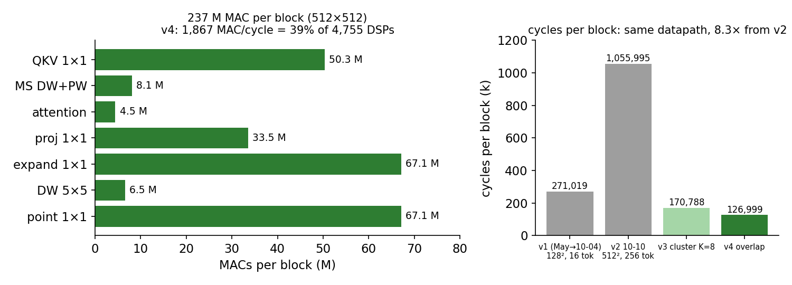
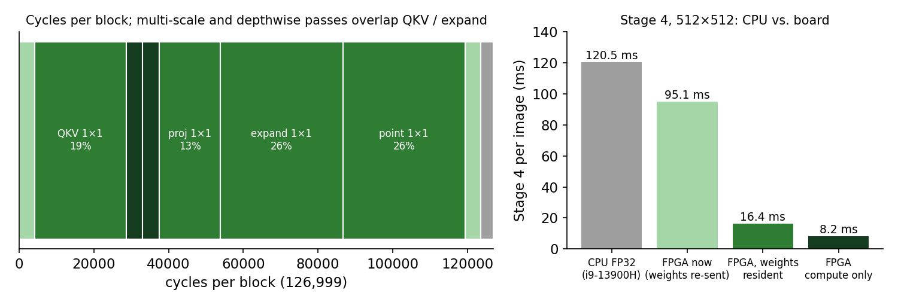
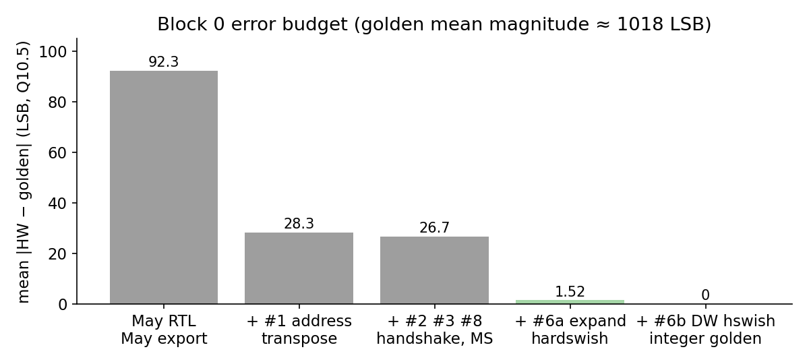

# Design notes

How the Stage 4 accelerator is built and why, how it went from the first working version to v4.1, and what is still missing. The headline numbers are in the README.

## Contents

1. [Scope](#scope)
2. [Fixed-point arithmetic](#fixed-point-arithmetic)
3. [Verification method](#verification-method)
4. [Datapath](#datapath)
5. [Schedule and cycle breakdown](#schedule-and-cycle-breakdown)
6. [Version history](#version-history)
7. [Debugging story](#debugging-story)
8. [Implementation and board results](#implementation-and-board-results)
9. [Limits](#limits)
10. [Next steps](#next-steps)

## Scope

EfficientViT-Seg-B1 has four backbone stages after its input stem. The last one, Stage 4 (`backbone.stages[3]` in the code), opens with a stride-2 MBConv that takes the feature map from 128 to 256 channels, followed by four identical `EfficientViTBlock`s. The accelerator runs those four blocks. Each block is

1. a LiteMLA module: QKV 1x1 convolution (256 to 768 channels), a multi-scale branch (5x5 depthwise plus grouped 1x1 on q, k and v), ReLU linear attention over 16 heads of dimension 16 for each of the two branches, projection 1x1 (512 to 256) and a residual add;
2. an MBConv: expand 1x1 (256 to 1024) with hardswish, 5x5 depthwise with hardswish, point 1x1 (1024 to 256) and a residual add.

A 512x512 input gives a 16x16 feature map at Stage 4, so a block works on 256 tokens of 256 channels. One block costs 237 M multiply-accumulates (MAC). The four 1x1 convolutions are 92% of them (QKV 50.3 M, projection 33.5 M, expand 67.1 M, point 67.1 M); the multi-scale branch is 8.1 M, the attention 4.5 M and the MBConv depthwise 6.5 M.

The four blocks have the same shape, so one RTL design runs all of them by loading a different weight set. The stem, Stages 1 to 3, the stride-2 MBConv at the start of Stage 4 and the segmentation head stay in PyTorch (FP32) on the host. The host sends the Stage 4 input over PCIe, the board returns the block output, and the network continues on the CPU. This puts the accelerator inside the real network instead of testing it only on stored vectors.

## Fixed-point arithmetic

Everything is int16. The rules are the same in the RTL, in `model/rtl_model.py` and in `model/evit_hw_golden/evit_hw_golden.py`.

| Quantity | Format |
|---|---|
| Activations and biases | Q10.5 (5 fractional bits, 1 LSB = 1/32) |
| Weights | Q4.11 (11 fractional bits); convolution and BatchNorm are fused before quantisation |
| Accumulators | 48-bit partial sums, no saturation inside a sum |

- Convolution (1x1, depthwise and grouped): accumulate the products, add 2^10, shift right arithmetically by 11 (round half up), add the bias, saturate to int16.
- Hardswish: `t = clamp(x + 96, 0, 192)`, `y = (x * t * 87381 + 2^23) >> 24`, and `y = x` once `x + 96 >= 192`. It is applied after the expand convolution and after the MBConv depthwise. For all 65,536 int16 inputs it gives the same result as rounding the floating-point hardswish.
- Linear attention: ReLU on q and k. v gets a 17th column holding the constant 32 (1.0 in Q10.5). The context is `ctx[r][c] = sum_t k[t][r] * v[t][c]`, then `out[t][c] = sum_r q[t][r] * ctx[r][c]`; neither product is shifted. Column 16 is the denominator, replaced by 1 when it is not positive. The quotient is `floor((numerator << 16) / denominator)`, followed by `(quotient + 2^10) >> 11` and saturation. The RTL uses a 64-bit pipelined divider for this.
- Residuals: saturating int16 adds, `mid = sat(x + proj)` and `y = sat(mid + pw)`.
- Block input: block 0 receives the FP32 output of the layers before it, rounded to Q10.5. Each later block takes the previous block's integer output.

Q10.5 turned out to be enough. Over 200 KITTI images the integer path scores 44.52% mIoU against 43.26% for FP32; the mean per-image difference is -0.22 points with an uncertainty of about +/-0.4 points, so no accuracy loss can be measured. An earlier belief that the Q10.5 range was too small came from a missing hardswish (see [Debugging story](#debugging-story)).

## Verification method

Cosine similarity against FP32 was the first check and it was not enough: with a transposed read address and a wrong channel order in the RTL, block 0 still reached a cosine of about 0.99. The project therefore moved to bit-exact checking against two integer models written separately:

1. `model/rtl_model.py`, a NumPy model written from the RTL: same channel order, shifts, rounding, saturation and divider. It can switch known bugs on, and with them on it reproduced the old simulation dumps exactly, so every difference from the float network could be traced to a specific, located bug.
2. `model/evit_hw_golden/evit_hw_golden.py`, written from the PyTorch network in PyTorch channel order without reading the first model. It generates the weights, the block inputs and the expected output of every stage.
3. The testbench `tb/tb_fused.sv` dumps every stage (q, k, v, multi-scale, both attention halves, projection, depthwise, point, y). The first stage that is not 100% equal is where the bug is.
4. The board runs the same vectors and is compared word by word.

The two models agree on all ten stages of all four blocks, simulation agrees with them, and the board output equals them bit for bit. Because the board is bit-exact with the integer model, dataset accuracy can be computed on a CPU with `--backend model`; the board is needed only for timing.

New scheduling ideas (shadow weights, the dual context banks, the overlapped passes) were each checked in a cycle-level Python model before they went into RTL, and every RTL version had to reach 0 LSB error in simulation before the next change.

## Datapath

The top-level module is `rtl/accelerator_top.v`. Its FSM steps through LOAD_X, M1 (QKV), ATT_Q, ATT_MS, M3 (projection), P2 (expand), P3 (point) and P4 (residual adds into the output BRAM). The block-design wrapper `Efficient_vit_v2_v1_0.v` connects it to the host-side BRAMs, and the AXI-Lite slave exposes `start`, `done` and a 32-bit cycle counter.

### Conv cluster with shadow weights

`rtl/conv_cluster.v` runs all four 1x1 convolutions. It holds K = 8 weight-stationary 16x16 systolic arrays. Each array owns one 16-channel output chunk, so the cluster produces eight output chunks at once while a single activation word per cycle feeds all eight arrays.

Each processing element (`pe_sw`) has two weight registers: the active weight and a shadow weight. While the current tile streams its 256 tokens, the next tile's weights shift into the shadow chain. A flag that travels with the first token of the next tile makes each PE switch to the shadow weight exactly when that token arrives. Tiles therefore run back to back with no pipeline flush and no weight-load bubble. The constraint is that loading the next tile's weights must finish within one tile, which gives `K * 16 <= N_TOKENS - 34`; with 256 tokens, K = 8 fits.

Results go into eight-bank SRAMs (`banked_sram`), one bank per array, so all eight output chunks are written in the same cycle. The arithmetic is the same as in the single-array engine (`conv_engine_top.v` with `psum_buffer.v`), which the multi-scale branch still uses for its grouped 1x1.

The cluster replaced a single 16x16 array and cut cycles per block from 1,055,995 to 170,788 (6.2x).

### Attention with two context banks

`rtl/litemla_core2.v` computes the linear attention for one head at a time in two phases. Phase 1 accumulates the 16x17 context from k and v. Phase 2 streams q through the multiply-accumulate and divider pipeline (results come out about 70 cycles after the input). The core has two context banks: phase 1 of head h+1 fills one bank while phase 2 of head h reads the other, and each q carries its bank id through the pipeline. The q tokens of consecutive heads therefore stream without a gap. The earlier single-bank core, `rtl/litemla_core.v`, is kept for reference and is no longer instantiated.

### Depthwise engines that trail the cluster

Two `dw_conv_engine` instances with line buffers (`dw_line_buffer.v`) handle the 5x5 depthwise work:

- the multi-scale branch: 5x5 depthwise on each q, k and v chunk, then the grouped 1x1, writing q2, k2 and v2. It starts on a chunk as soon as the cluster has written that chunk during M1, so it runs underneath the QKV convolution;
- the MBConv depthwise with hardswish, which follows the expand convolution (P2) group by group in the same way.

## Schedule and cycle breakdown

Cycles per block in the final version (126,999, the same on every run and for every block):

| Part | Cycles | Share |
|---|---|---|
| Conv cluster: QKV, projection, expand, point (416 steps x 256 tokens) | 106,496 | 84% |
| Attention, two branches (2 x 17 x 260) | 8,840 | 7% |
| Input load and output write (2 x 4,096 words) | 8,192 | 6% |
| Bias loads, weight preload and waits | 3,471 | 3% |

The multi-scale and depthwise passes do not appear as separate rows because they run in the shadow of QKV and expand. The cluster is busy 84% of the block, so within the current size (eight arrays) and clock there is little scheduling headroom left. Averaged over the block, the design performs 1,867 MAC per cycle, which uses 39% of the 4,755 DSPs.

## Version history

All versions after v1 run the same 512x512 workload with the same arithmetic; only the schedule changed, so the golden vectors stayed the same.

| Version | Input | Cycles per block | Change |
|---|---|---|---|
| v1 (2026-10-04) | 128x128, 16 tokens | 271,019 | Three functional bugs fixed, two hardswish stages added, multi-scale channel order corrected |
| v2 (2026-10-10) | 512x512, 256 tokens | 1,055,995 | 256 tokens, pipelined attention, flush based on counters |
| v3 | 512x512 | 170,788 | Conv cluster: eight arrays, shadow weights, eight-bank SRAM (6.2x) |
| v4 | 512x512 | 126,999 | Multi-scale branch overlapped with M1, dual-bank attention, depthwise overlapped with expand (another 1.34x) |
| v4.1 (2026-10-10) | 512x512 | 126,999 | Fix for state carried between runs (`cl_groups_done` cleared one cycle earlier) |

From v2 to v4 the cycle count fell 8.3x. The v1 number is for a different workload (16 tokens) and is not comparable.

## Debugging story

Before the bit-exact flow, block 0 ran on the RTL inside the real network at 128x128 with a cosine similarity of 0.989 and 98.5% mask agreement, but blocks 1 to 3 saturated and the final mask was close to random. The multi-scale branch was forced to zero, and the working theory was that Q10.5 did not have enough range.

Measured as the mean absolute difference between hardware and the integer golden for block 0 (the golden values average about 1,018 LSB in magnitude), the error came down in steps as separate bugs were found:

| After fixing | Mean error, block 0 (LSB) |
|---|---|
| Starting point | 92.3 |
| #1 mid SRAM written token-major but read chunk-major | 28.3 |
| #2 attention handshake, #3 multi-scale output tied to 0, #8 weight channel order | 26.7 |
| #6a ReLU6 after expand where the model uses hardswish | 1.52 |
| #6b missing hardswish after the MBConv depthwise | 0 |

The 14 bugs found and fixed:

| # | Where | Problem | Fix |
|---|---|---|---|
| 1 | top FSM | mid SRAM written token-major, read chunk-major | matching address order |
| 2 | attention | `valid` not gated by `ready`: token 0 counted twice, last token dropped, q off by one | use `ready && valid` |
| 3 | top FSM | multi-scale attention output tied to 0 | write it |
| 4 | wrapper | multi-scale weight ports missing | eight ports added |
| 5 | AXI slave | 16-bit cycle counter, never cleared | 32 bits, cleared on start |
| 6a | top | ReLU6 after expand; the model uses hardswish | hardswish |
| 6b | top | no activation after the depthwise convolution | second hardswish (`DW_ACT=1`) |
| 7 | testbench | golden file missing, last token skipped | fixed |
| 8, 9 | vector export | weights in PyTorch channel order | permuted to hardware order |
| 10 | block design | depthwise weight BRAM too small | 1 MB, two BRAMs |
| 11 | host | fixed sleep instead of polling `done` | poll |
| 12 | top | a counter driven from two `always` blocks | single driver |
| 13 | top (v4) | multi-scale branch started early and read the previous block's data | clear the counter in the start state |
| 14 | simulation script | block sequence "01" parsed as the number 1 | compare as a string |

Bug 6b explains the saturation. Without the hardswish after the depthwise, the block 0 point-convolution output peaked at about 144 instead of under 4, and each following block amplified it until values hit the int16 limit. With the activation in place nothing saturates, which is why the range theory was wrong.

### The board-only bug (13)

Bug 13 was the only one introduced by the new scheduling, and it appeared only on the board. Blocks 1 and 3 were off by 1.0 and 3.4 LSB on average, but only when the previous run on the board had been a different block. Running the same block twice was correct, blocks 0 and 2 were always correct, and every block passed in simulation, where each run started from reset.

The multi-scale branch must wait until the cluster has written QKV chunk 0 before it reads it, and it learns this from a counter, `cl_groups_done`. That counter was cleared on `cl_start`, one cycle after the multi-scale FSM left idle. From the second run on, the FSM saw the count left over from the previous run's point convolution, started about 4,000 cycles early and read q chunk 0 of the previous block. After reset the count is zero, which is why simulation never showed it.

Before changing the RTL, `model/check_stale_ms.py` computed the error for every (previous block, current block) pair under this hypothesis. It predicted 0.99 LSB for block 1 after block 0 and 3.46 LSB for block 3 after block 1, and 0 for blocks 0 and 2; the board had shown 1.0 and 3.4. Only then was the fix made: one line that clears the counter in the `S_*_START` state. The testbench now runs several blocks back to back without reset (`+SEQ=13` runs block 1 and then block 3), and the fix was confirmed by 0 LSB in that simulation, nine board runs in the mixed order `0 1 1 3 3 2 0 2 1`, and 800 of 800 bit-exact block runs over the 200-image KITTI batch.

## Implementation and board results

Full numbers are in [`results/implementation_summary.md`](../results/implementation_summary.md), [`results/board_v41/bench.json`](../results/board_v41/bench.json) and [`results/board_v41/results.json`](../results/board_v41/results.json).

| Item | Value |
|---|---|
| Clock | 62.5 MHz; the board cycle counter divided by measured compute time gives 61.9 MHz |
| Timing | WNS +0.532 ns, WHS +0.009 ns, 0 failing endpoints; worst path is reset recovery from the XDMA user reset |
| LUT / FF | 264,391 (20.3%) / 273,825 for the full design; 229,824 / 219,290 in the accelerator |
| RAMB36 | 1,703 (84.5%) for the full design; 770 in the accelerator, 933 in the host-side BRAMs |
| DSP | 4,755 (52.7%), all in the accelerator |
| URAM | 0 |
| Power | 11.13 W on chip (7.75 W dynamic, 3.39 W static), Vivado estimate |
| Cycles per block | 126,999 |
| Time per block on the board | weight upload 19.7 ms (2.33 MB at 118 MB/s), input 0.93 ms, compute 2.05 ms, readback about 1.1 ms (medians of 20) |
| Stage 4 per image | 95.1 ms with weights re-sent, 16.4 ms with weights resident, 8.2 ms compute only; 16.9 ms per image (59.2 images/s) over the 200-image batch |
| Throughput | 115.6 GMAC/s = 231 GOPS compute only; about 21 GOPS/W with the estimated power |
| CPU reference | 120.5 ms for the same four blocks in FP32 on an i9-13900H (torch 2.6, median of 10), 14.7x slower than board compute |
| Accuracy (200 KITTI images) | mIoU 43.26% FP32, 44.52% hardware path |

## Limits

- The PCIe link trained at Gen1 x1 (checked with `lspci`), so a block's 2.33 MB of weights takes 19.7 ms to upload against 2.05 ms of compute. With weights re-sent for every image, 79 of the 95 ms per image are weight transfer.
- The whole design runs on the XDMA's 62.5 MHz `axi_aclk`; the accelerator has no clock domain of its own yet.
- BRAM is at 85% while URAM is unused. The expand buffer (`sram_exp`) lands in BRAM because `banked_sram` has an unused second read port.
- Each block needs its own start command and its own round trip from the host; chaining four blocks needs a block counter, weight switching and a new address map.
- One DSP performs one 16-bit multiply. INT8 would let one DSP do two, so the current design cannot match INT8 designs in throughput per DSP.
- Not done: INT8 arithmetic, a 16-array cluster, the classification stem and Stages 1 and 2, token batching. The power figure is a Vivado estimate.

## Next steps

In order of expected return:

1. Configure the XDMA for Gen3 x8 and check the slot. Weight upload would fall from about 79 ms to under 3 ms per image and a full image from about 95 ms to about 17 ms, with no RTL change.
2. Remove the unused second read port (`raddr2`) from `banked_sram` so that `sram_exp` maps to URAM, freeing about 230 BRAMs.
3. Give the accelerator its own 200 MHz clock domain: add a clock wizard to the block design, synchronise `start`, `done` and the cycle counter, add two pipeline stages (BRAM to the adder array and cluster input; the 272 attention multiply-accumulates) and possibly reschedule the 32-stage 64-bit divider. Estimated 0.64 ms per block, about 740 GOPS.
4. Keep the 9.3 MB of weights resident in URAM, run all four blocks from one start, and double the cluster to 16 arrays (which needs two weight read ports). Estimated 0.37 ms per block, about 1.35 TOPS. These are paper estimates.
5. Only then INT8 arithmetic or token skipping, each step checked with the same bit-exact flow and a new mIoU measurement.
